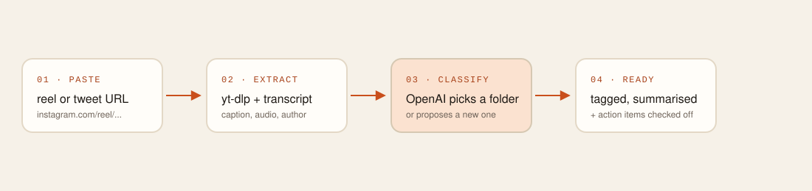

<div align="center">
  
</div>

<div align="center">

[](.node-version)
[](tsconfig.json)
[](web/package.json)
[](src/mcp/server.ts)
[](#license)

</div>

<br/>

You save things everywhere — a reel on Instagram, a tweet on X — and none of it ends up anywhere useful. **myBucket** is one inbox for all of it. Paste a link and it fetches the caption and audio, transcribes it, and asks an LLM to file it into a folder — one that already exists, or a brand new one it proposes on the spot. No tag taxonomy to maintain. The folders *are* whatever you actually save.

Once it's filed, it's queryable from anywhere an MCP client can reach: ask Claude *"what have I saved about home workouts?"* and it searches your bucket directly.

<br/>

<div align="center">
  
</div>

<br/>

## Contents

- [What it does](#what-it-does)
- [Architecture](#architecture)
- [Tech stack](#tech-stack)
- [Project layout](#project-layout)
- [Getting started](#getting-started)
- [API](#api)
- [MCP tools](#mcp-tools)
- [Web dashboard](#web-dashboard)
- [Status](#status)

<br/>

## What it does

| | |
|---|---|
| **Save** | Paste an Instagram reel or X/Twitter link. The URL is normalized (tracking params stripped) and hashed so re-saving the same post is a no-op instead of a duplicate. |
| **Extract** | Instagram reels go through `yt-dlp` for metadata and audio, then a Groq-hosted Whisper model for a fast transcript. Tweets are pulled directly. |
| **Classify** | The combined text goes to OpenAI with the user's existing folder names + descriptions. It returns a title, one-line summary, tags, an intent (`learn` / `try` / `buy` / `visit` / `apply` / `watch` / `inspire`), concrete action items, and either a matching folder or a brand-new one — proposed only while the user is under their folder cap. |
| **Find it again** | Full-text search over everything saved, filterable by folder or platform — from the dashboard or from any MCP client. |

Folders aren't predefined categories you pick from a dropdown — they're discovered from what you actually save, up to a configurable cap (`FOLDER_CAP`) before new items fall back to a catch-all.

<br/>

## Architecture

```
┌──────────────┐        ┌──────────────────────────┐        ┌──────────────┐
│  Next.js UI   │──────▶│   Express API (:4000)     │──────▶│   MongoDB     │
│  web/         │  REST  │   src/api/                │ Mongoose│  items ·     │
└──────────────┘        │                            │        │  folders ·   │
                         │  ┌──────────────────────┐  │        │  users ·     │
┌──────────────┐  Bearer │  │  MCP router (/mcp)    │  │        │  tokens      │
│  Claude /     │────────▶│  Streamable HTTP, one  │  │        └──────────────┘
│  any MCP      │  token  │  stateless server per  │  │
│  client       │        │  request                 │  │
└──────────────┘        │  └──────────────────────┘  │
                         │                            │
                         │  ┌──────────────────────┐  │        ┌──────────────┐
                         │  │  processItem()        │──┼───────▶│  yt-dlp +     │
                         │  │  extract → transcribe  │  │        │  Groq Whisper │
                         │  │  → classify            │──┼───┐    └──────────────┘
                         │  └──────────────────────┘  │   │
                         └──────────────────────┬─────┘   └───▶ ┌──────────────┐
                                                  │              │  OpenAI       │
                                                  └─────────────▶│  classifier   │
                                                                 └──────────────┘
```

Saving is **synchronous, not queued** — the request that creates an item stays open through extraction and classification, then returns the finished document. There's no job worker and no polling; the dashboard's "Fetching caption → Transcribing → Picking a folder" state is just what that one request looks like while it's in flight.

Two auth paths sit side by side: a short-lived **session cookie** (JWT) for the web dashboard, and a long-lived **personal access token** (bcrypt-hashed, shown once) for the MCP endpoint — so an AI client can search your bucket without ever holding your password.

<br/>

## Tech stack

<table>
<tr><td valign="top">

**Backend**
- Express + TypeScript
- MongoDB / Mongoose
- `@modelcontextprotocol/sdk` (Streamable HTTP)
- OpenAI (`gpt-4o-mini`, structured outputs via Zod)
- Groq Whisper (`whisper-large-v3-turbo`) for transcription
- `yt-dlp` for Instagram extraction
- JWT sessions + bcrypt access tokens

</td><td valign="top">

**Web dashboard** (`web/`)
- Next.js 15, App Router
- React 19 + TypeScript
- Tailwind CSS v4, custom design tokens
- `next/font` — Instrument Serif, Geist, Geist Mono
- No state library — currently mock data in `lib/data.ts`, wired for a direct swap to the real API

</td></tr>
</table>

<br/>

## Project layout

```
src/
  api/              Express app, routes (auth, items, folders, search, tokens)
  auth/             JWT sessions, access tokens, bcrypt, middleware
  classification/   OpenAI classifier + folder-matching logic
  config/           env parsing
  db/                mongoose connection + models (user, item, folder, accessToken)
  integrations/
    instagram/      yt-dlp extraction, Whisper transcription, URL validation
    twitter/        tweet extraction, validation
  items/            URL normalization/hashing, the save pipeline, search
  mcp/              MCP server (tools) + router (Streamable HTTP transport)
  server.ts         entrypoint — connects DB, starts the Express app

web/
  app/              routes: dashboard, folders, settings
  components/       dashboard, folders, settings, auth, ui primitives
  hooks/            useSaves (API-bound state), useNow
  lib/              types, API client, adapters, folders/recipes/topics helpers
```

<br/>

## Getting started

**Backend**

```bash
npm install
cp .env.example .env     # MongoDB URI, OpenAI key, Groq key, JWT secret, FOLDER_CAP
npm run dev               # starts the API on :4000
```

Instagram extraction needs [`yt-dlp`](https://github.com/yt-dlp/yt-dlp) on your `PATH` (override with `YTDLP_PATH`).

**Dashboard**

```bash
cd web
npm install
npm run dev               # http://localhost:3000
```

| Variable | Purpose |
|---|---|
| `MONGODB_URI` | connection string |
| `OPENAI_API_KEY` / `OPENAI_CLASSIFY_MODEL` | classification |
| `TRANSCRIBE_API_KEY` / `TRANSCRIBE_BASE_URL` / `TRANSCRIBE_MODEL` | Groq Whisper transcription |
| `YTDLP_PATH` / `REEL_PROCESSING_TIMEOUT_MS` | Instagram extraction |
| `JWT_SECRET` | signs the session cookie |
| `FOLDER_CAP` | max non-Inbox folders before new items fall back to Inbox |

<br/>

## API

All routes below (except `/health`) require the `session` cookie set at login.

| Method | Route | Does |
|---|---|---|
| `POST` | `/api/items` | Save a URL — blocks until extraction + classification finish |
| `GET` | `/api/items` | List items, filterable by `folder` / `status` |
| `GET` | `/api/items/:id` | Fetch one item |
| `PATCH` | `/api/items/:id` | Move folders, edit title, toggle action items |
| `DELETE` | `/api/items/:id` | Remove an item |
| `POST` | `/api/items/:id/retry` | Re-run a failed item through the pipeline |
| `GET` / `POST` | `/api/folders` | List / create folders |
| `GET` | `/api/search` | Full-text search |
| `POST` | `/api/auth/*` | Login / logout / session |
| `POST` | `/api/tokens` | Mint a personal access token for MCP (shown once) |

<br/>

## MCP tools

Connect any MCP client to `/mcp` with `Authorization: Bearer <personal-access-token>`. Each request spins up a fresh, stateless server scoped to that token's user:

| Tool | Does |
|---|---|
| `search_saves` | Text search across saved items, filterable by folder / platform |
| `get_save` | Fetch one item in full — transcript, action items, everything |
| `list_folders` | Folders with item counts |
| `save_link` | Save a new URL — runs the full pipeline before returning |
| `complete_action` | Check off one action item on a saved item |

<br/>

## Web dashboard

The dashboard currently runs on mock data (`web/lib/data.ts`) so the UI could be built ahead of the API — a sidebar of folders, one box that saves a pasted link or searches typed words, a row of due reminders, and a detail panel per item. `web/hooks/useSaves.ts` is the single seam where mocked calls get swapped for the real routes above.

| Token | Value | Use |
|---|---|---|
| `paper` | `#F6F1E8` | page background |
| `card` | `#FFFDF9` | cards, inputs |
| `ink` | `#1F1A15` | text, dark buttons |
| `ember` | `#C94F1C` | the one primary action color |

See [`web/README.md`](web/README.md) for the full component map and design tokens.

<br/>

## Status

Backend, auth, MCP server, and the classification pipeline are implemented and wired together. The dashboard is being switched over from mock data to the live API — folders and settings pages are the current focus.

<br/>

## License

MIT
